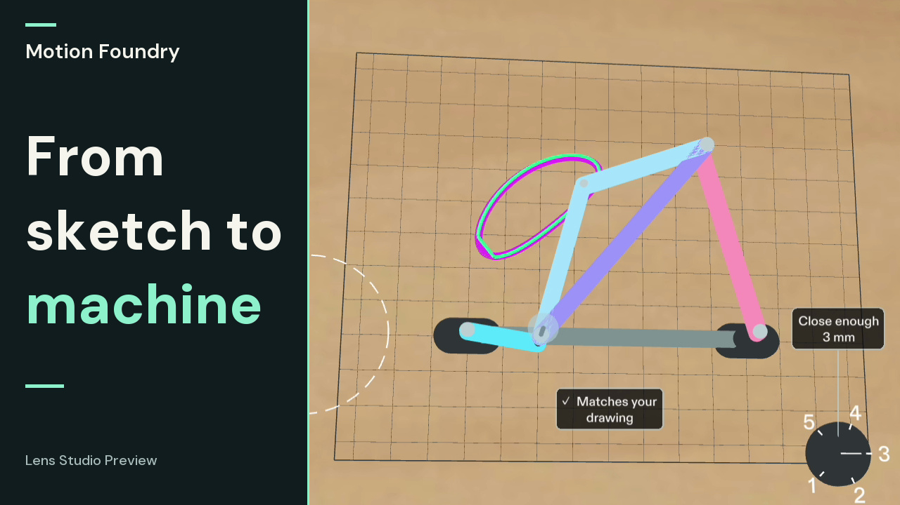

# Motion Foundry

Draw a curve on your workbench, find a machine that draws it back, and turn its crank by hand.

[Watch Motion Foundry](https://youtu.be/6Qy_kei3IiA) · [Preview gallery](devpost/gallery.md)

[](https://youtu.be/6Qy_kei3IiA)

Motion Foundry is a SPECS Lens for people designing moving sculptures and small mechanisms. Sketch at true scale on the bench where you would build, turn the links by hand, and see where they meet your mug—without carrying a second screen.

- **Information on the object:** fitting gaps sit beside the drawing; contact marks the rod that hits; the fit limit lives on a dial.
- **Detail when it helps:** approach to inspect lengths and gaps, step back for one status mark, and hover over a part to see its glow and gesture hint.
- **Hands before menus:** draw, crank, turn the dial, move a mount and size an obstacle directly. The dock has at most three targets, with Back and a nearby Undo chip.
- **A workbench in your space:** the board stays on the table. During placement, controls remain within reach; the saved design appears beside the machine.

## Open the Lens

1. Open [lens/MotionFoundry.esproj](lens/MotionFoundry.esproj) in **Lens Studio 5.23.2**. Its package dependencies and authored scene are included.
2. Select **Interactive Preview → Sunlit Room**. Use SPECS 27, or Horizontal Preview with the SPECS Device Override.
3. Turn the grip, or choose **Draw** and pinch-drag on the board. Returning to the starting ring closes the loop. **Make it** searches for a new mechanism; the pen then traces the path produced by its actual rods.
4. Grab the dashed ring to add the mug stand-in. Move the ring and pull its rim handle to set the keep-out size. If a rod hits it, choose **Avoid mug**; the search keeps your drawing, mounts, fit limit and obstacle unchanged.
5. **Save** keeps the design locally. Choose **Send to phone** to show its signed Preview QR/link, then open that link in the companion.

In Preview the workbench starts at a hand-measured spot; **More → Place** starts surface placement. The device branch asks you to look at a table and pinch to place it.

The native starter has **16 cm mount spacing** and a **3 mm fit limit**. Its rods are 0.45 cm in radius and 0.70 cm deep, on distinct height layers. The mug stand-in starts at 9 cm across and 4 cm high. These are explicit numerical inputs, not a visual enlargement of the web example.

## Companion

[Open the companion](https://motion-foundry-nine.vercel.app) to explore Loop or the retained Petal angular-motion mode. The web Loop example uses **8 cm mounts and a 1.5 mm fit limit**. Signed native designs preserve their own dimensions; the companion rechecks them and offers JSON and a dimensioned SVG.

Run locally with Node.js 22:

```sh
npm ci
cp .env.example .env
npm run dev
```

Open `http://localhost:3101`. Numerical design needs no model key. Optional Petal language proposals remain unverified until the numerical solver checks them. Signing and model credentials stay on the server.

```sh
npm run verify
npx tsc -p tsconfig.lens-source.json --pretty false
npm run lens:check
```

See [reproduction steps](devpost/reproducibility.md) for native tests, configuration and recovery cases; [technical reference](devpost/technical-reference.md) for the model, API and sharing format.

## Built with

- [Devpost Learn skill pack: plan-lens](https://github.com/challengepost/learn-specs/tree/main/skills/plan-lens), applied as the framework for the [design brief](devpost/design-brief.md).
- CLAD and Lens Studio MCP for native implementation, scene integration and Preview inspection.
- Lens Studio 5.23.2, Spectacles Interaction Kit 2.0.0, Spectacles UIKit 2.0.0 and official 3D Hints 2.0.0 for spatial input and presentation.
- LEAF 2.0.2 for scripted native interaction checks of drawing, live synthesis, cranking, same-drawing mug repair and exact Undo. Optional scenarios remain in `lens-src/tests/` and `lens/Assets/Scripts/Tests/`; the shipping scene has no active test registry, messaging bridge or measurement helper.
- TypeScript, Next.js, React, Three.js and Vitest for the numerical core and companion. [Dependency notices](THIRD_PARTY_NOTICES.md).

## Scope

Testing and footage use Lens Studio Preview and simulated input, including visible synthetic SIK hands. Physical Spectacles hand tracking, comfort, performance and phone scanning have not been tested. The mug is a Preview stand-in inside a manually sized obstacle cylinder; on the device branch the prop is hidden and the ring remains for manual alignment. There is no object recognition or scanning. A paired-phone send API is future work; the current handoff is the Preview QR/link.

The model checks a full crank turn, then tests fit and clearance at many positions. Contact between those positions and whether the machine can be built remain unchecked. A failed search keeps the previous machine; another workable design may still exist.

[Verification](devpost/verification.md) · [Design and documentation index](devpost/README.md)
