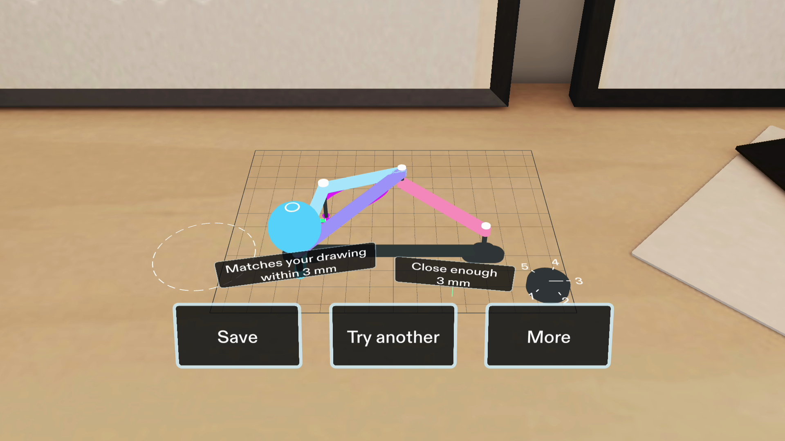
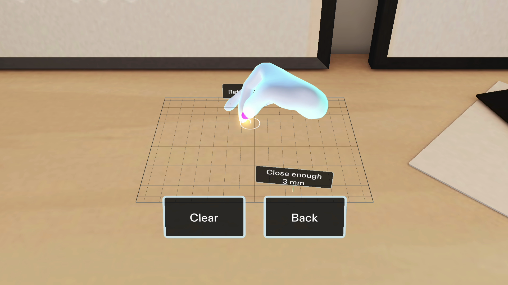
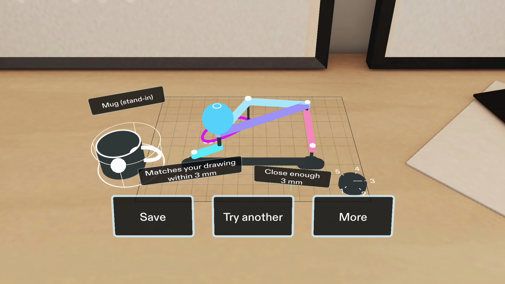
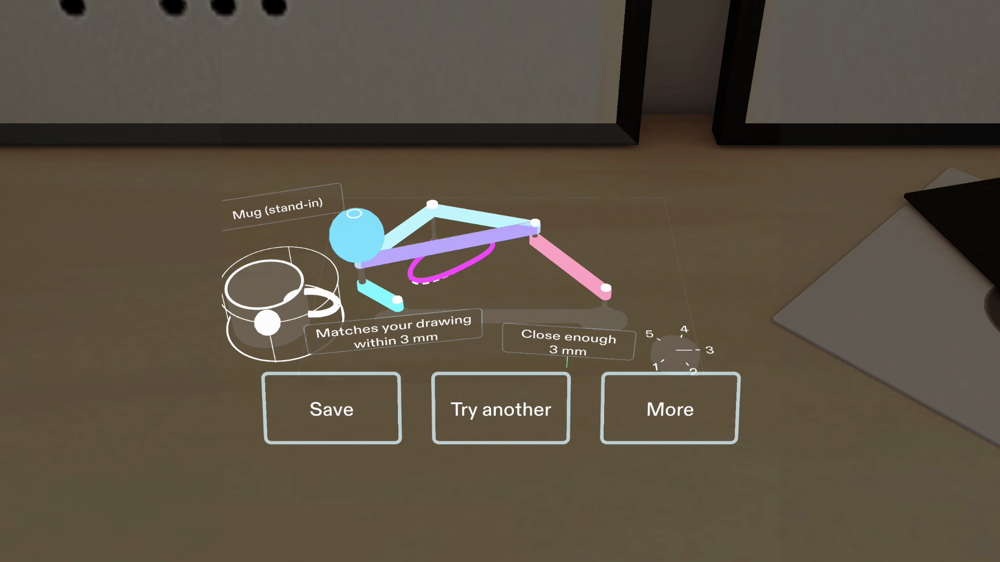

# Motion Foundry in Preview

A closed drawing becomes a moving linkage on the workbench. These four images show the actual Lens running in Sunlit Room.

## The workbench

Turn the crank to move the links and trace the drawing. The fit dial and mount are physical controls beside the parts.

## Drawing by hand

The nib follows the pinch point. Returning close enough to the start snaps the loop closed; the actual captured points become the next request.

## Clearing the mug

The new crank completes its turn beside the mug while the drawing, mounts and allowed gap stay fixed. The magenta trace comes from the moving mechanism.

## Glasses simulation

Bright rods, ink and control rims remain distinct in the additive Preview mode.

## Scope

These are native Preview images with scripted SIK input, not physical glasses photographs. The mug is a manually sized stand-in; there is no automatic object recognition or measurement. Numerical checks cover the modeled rods and obstacle. See [Scope](../README.md#scope), [verification](verification.md) and the [image provenance](evidence/native-workbench-gallery.json).
