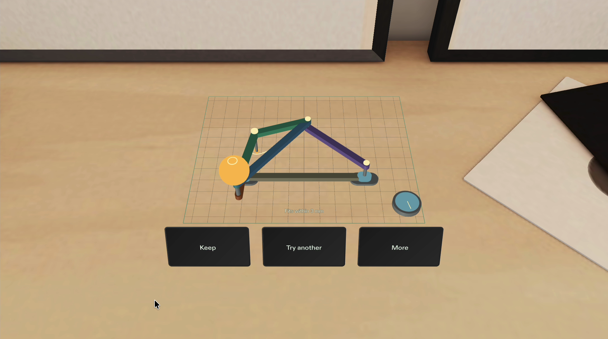
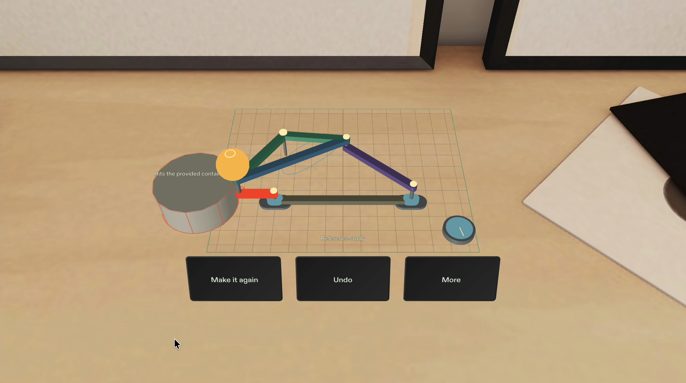
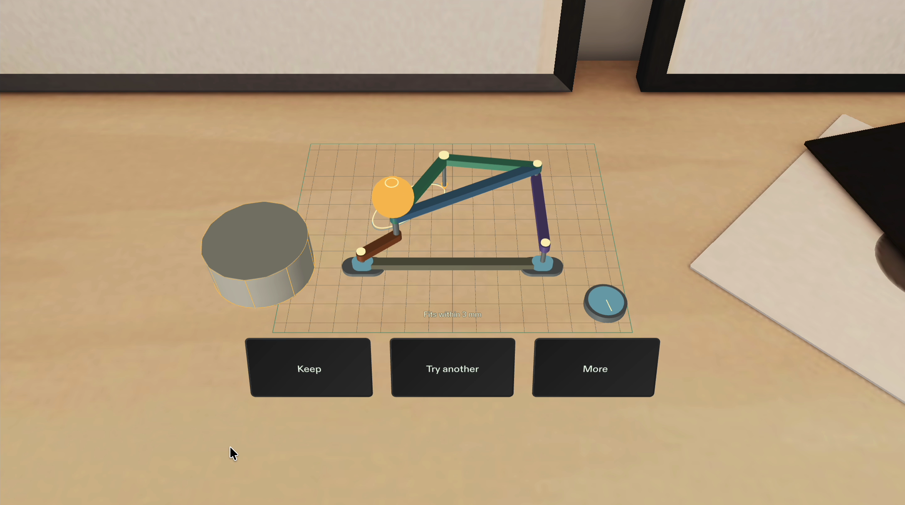
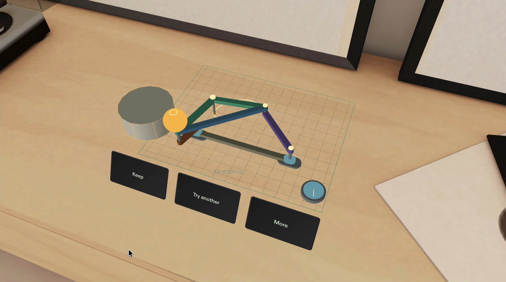

# Motion Foundry — actual Preview gallery

These are fixed crops of independently accepted Lens Studio Preview frames in Sunlit Room. No room background, product UI or mechanism was added in post-production. The [capture record](evidence/native-tabletop-captures.json) binds every image to its source frame, hash and approved crop.

## Draw a machine

The captured drawing produced a new linkage with 0.064951 cm maximum error under a 0.30 cm limit. This take used an automated SIK gesture following a supplied reference-path stroke. The ink comes from actual linkage poses; it is not target interpolation or human freehand footage.

## A separate reference study

Study loads its own reference drawing and the provided 9 cm diameter × 4 cm high container. The original crank physically overlaps the declared envelope by 0.050 cm. Including the requested separation, the signed margin is −0.210 cm. The native contact label is partly occluded at this pose; the red rod and container are the visible witness.

Fresh HTTPS synthesis keeps every Study input unchanged and replaces the mechanism. The selected crank is 3.766742 cm, maximum error is 0.242353 cm, and sampled margin after required separation is +0.023258 cm. These are sampled rod checks, not a fabrication or continuous-collision guarantee.

## Inspect it in space

The camera moves in the native Preview room. Rod layers and through-axles provide depth cues. Axles, clamps, the large grip and pen hardware remain outside the solver's declared rod-clearance scope.

The actual SPECS Center capture is retained as a separate [verification image](media/native-tabletop-center.png), not a primary gallery frame. It preserves the native tint and wider view and makes no physical-glasses or comfort claim.

The revised side-tag and exact companion handoff are being captured separately. Earlier large-card or different-geometry exports are not reused as proof of this revised design.
