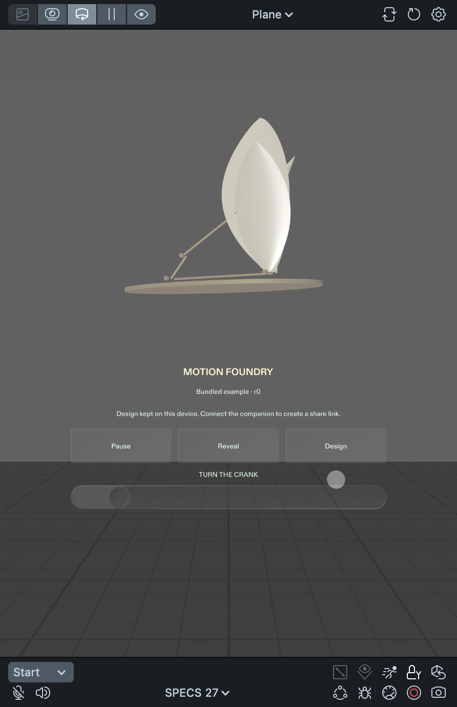
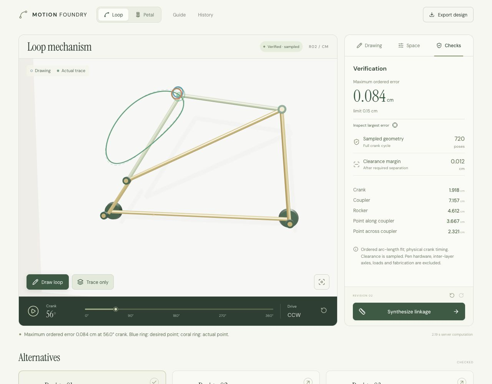
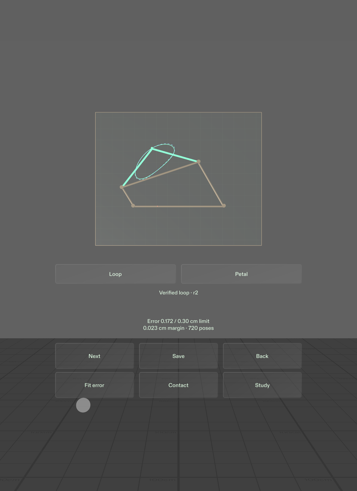

# Motion Foundry — implementation and iteration record

All observations below were made during the November 7, 2026 build. This record describes actual changes and checks, rather than an inferred user study.

| Observation | Change | Evidence |
| --- | --- | --- |
| A convincing moving flower alone would not establish a real mechanism. | Scoped the artwork to one rigid petal on a numerically solved four-bar rocker, with exposed links and joints. | Playback closure, held-out geometry, and independent-verifier tests pass. |
| Reusing a cached example could hide whether an obstacle influenced synthesis. | Added before/after fixtures with unchanged targets and a relocated capsule obstacle. | The old design fails the new obstacle; a fresh solve returns different passing dimensions. |
| A broad search can fail without proving impossibility. | Separated analytic contradiction detection from bounded-search exhaustion. | Conflicting same-phase targets report infeasible; a difficult obstructed search reports no-result. |
| Initial native controls created a large flat rack beside a small sculpture. | Enlarged the physical fixture with every centimetre quantity scaled together, removed the panel background, and introduced contextual control views. | Final Preview capture shows the sculpture above a compact three-control dock. |
| Programmatic UIKit layout initialization conflicted with automatic item discovery. | Disabled automatic discovery on authored FlexLayouts and populated them through the expected lifecycle. | Fresh native compile and runtime logs are clean. |
| Target dragging and normal rendering could compete for the handle position. | Added an explicit drag state; commit the completed drag as one revision. | Actual Preview drag changed a target, paused playback, and a subsequent solve returned new parameters. |
| Browser edits retained selectable alternatives from the prior input. | Disabled and dimmed old alternatives and labeled their previous revision. | Desktop browser review confirmed fresh solving and stale-state recovery. |
| A small obstacle's displayed radius did not match the slider step. | Matched the step to hundredth-centimetre values. | The control now represents the actual 0.12 cm fixture radius. |
| Undo initially restored a native candidate without restoring its alternatives. | Snapshot and restore the full alternative list. | After editing and solving, Undo followed by Next restores an original valid alternative. |
| Saving only into device storage was an incomplete cross-device handoff. | Added server-reverified signed links, QR rendering, a shared assembly preview, and JSON/SVG downloads. | Actual Preview pose edit → HTTPS solve → receipt Save passed; fresh bundled Save also passed. Both signed pages and JSON/SVG downloads returned HTTP 200. |
| OpenCV could not automatically locate the dense solved QR reliably. | Cross-checked the unchanged full Preview screenshots with ZXing. | ZXing automatically decoded both full screenshots to the exact runtime URLs. OpenCV also recovered both with crops and supplied corners for the solved card. No hardware scan was performed. |
| A shared mutable reference allowed one modified example to contaminate another. | Copy reference parameters when creating a workspace. | Invalid-export testing no longer affects later fixtures. |
| Long valid Unicode identifiers could create a token larger than the reader accepts. | Enforce byte and token limits before issuing a share; offer JSON export instead. | The boundary case returns HTTP 413 instead of an unusable signed link. |

The final web review covered desktop and a 390 × 844 mobile viewport. It included a real OpenAI proposal, accepting the edit, a fresh numerical solve, contradictory-input recovery, and exact-candidate downloads. The final local production shared page rendered the generated drawing and reopened the signed design without browser console errors.

This capture shows the final bundled browse/play state after the production integration pass. It is a Lens Studio Preview capture. The separate share-card capture and decoding results appear in the verification record.

## Loop redesign

The following work followed an independent review of the first implementation. It adds a new computational interaction, rather than duplicating decorative petals or adding more language prompts.

| Observation | Change | Evidence |
| --- | --- | --- |
| Angular targets are mathematically useful but abstract to a first-time viewer. | Made Loop the opening mode: draw a desired path, synthesize a rigid coupler attachment and trace it with a physical crank. Petal remains a separate mode. | Held-out coupler mechanisms, negative branch, attachment variation, reversed traversal and a physically generated self-intersecting loop pass independent checks. |
| An unordered nearest-point error could hide incorrect traversal. | Preserved ordered closed arc-length correspondence and explicit crank direction/start. | Reversing only target traversal fails; reversing physical drive appropriately passes. Reordered crossing paths are rejected. |
| Silently connecting an open stroke would change what the user asked for. | Added start-ring closure and an explicit Close loop action for a larger gap. | Actual browser pointer drawing stayed pending until Close; the resulting revised stroke synthesized with about 0.099 cm error. |
| Pure fitting followed by collision rejection could miss a usable compromise. | Added bounded obstacle penalties and retained clear candidates; final independent verification remains mandatory. | The canonical clearance study re-solves at unchanged 8 cm mounts and 0.15 cm tolerance, producing about 0.0844 cm maximum error and +0.01175 cm sampled clearance margin. The 2× numerical fixture also passes. |
| A single fit number does not explain a missed part of a drawing. | Added the physical crank phase, desired/actual points and an inspectable maximum-error segment. | The witness's actual position agrees with the separate playback evaluator. Actual browser review inspected the rendered witness. |
| Base-link collision failures lacked a location. | Added independent witnesses for crank, coupler, rocker and ground, alongside attachment witnesses. | Tests check the offending geometry, phase, obstacle, contact location and negative clearance. |
| Sharing floating-point strokes could exceed native QR capacity or alter inputs through rounding. | Canonicalized capture before solving, then losslessly delta-packed integer coordinates in 0.001 cm increments (0.01 mm); arbitrary API coordinates retain exact JSON. | Production share URL was 1,586 characters with a 133-module QR. Exact input and parameter round-trip passed. This is representational precision, not measurement accuracy. Both full native frames subsequently decoded to their exact raw-reference and solved-receipt URLs (1,390 and 1,598 characters). |
| Promotional copy competed with the mechanism. | Removed the hero slogan, decorative eyebrows, repeated descriptions and poetic alternative names; increased useful control contrast and scene size. | Desktop and 390 px mobile browser review found the mechanism in the first viewport with no horizontal overflow. |
| A no-fit request could erase useful work. | Kept the prior mechanism, explicit stale state and disabled export; retained revision guards across cancel/retry/undo. | A pointer-drawn large rectangle returned no-result, retained parameters, and recovered through Undo. Petal and Loop state remained separate across mode switches. |

The new native flow passed actual SIK drawing, explicit closure, changed HTTPS mechanisms, physical fit/contact witnesses, fixed-constraint repair, no-fit recovery, all scalar controls, Undo and Petal regression. Full-frame QR decoding and an independent browser download confirmed exact handoff. Supplemental delivery delays on genuine responses exercised cancel, undo, mode changes, both timeouts and overlapping Save retries. The [verification record](verification.md) gives the exact scope and separates desktop observations from untested hardware.

| Native acceptance observation | Change | Evidence |
| --- | --- | --- |
| A point grab/release without movement could add a revision; scalar callbacks had the same no-op path. | Compare exact completed coordinates and rounded scalar values before checkpointing. | Actual no-motion pen input preserved revision/hash/history; a fresh edited-point solve kept revision/history at one. The scalar same-value check was supplemental method evidence. |
| Filled fit indicators obscured each other when error was small. | Use blue/coral rings at the exact desired/actual positions, with a connector. | Actual largest-error inspection shows both rings at the computed physical crank phase. Rod geometry is unchanged. |
| Transport wording and repeated success prose competed with useful metrics. | Show Verified loop, keep transport source in diagnostics, and collapse the empty success-detail row. | Final native captures retain error, limit, clearance and pose count beside compact contextual controls. |
| A timed-out earlier Save could interfere with a newer request. | Give sharing a separate request generation. | Delayed genuine response from the older request arrived while the newer Save remained pending; loading stayed active and only the newer result installed. |

