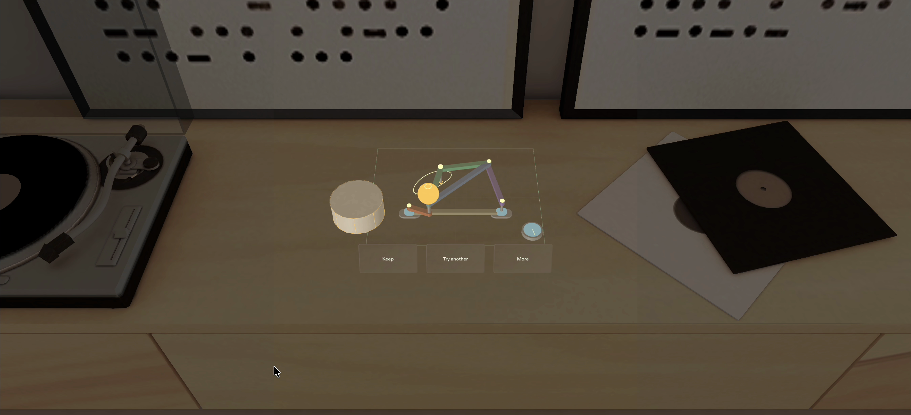
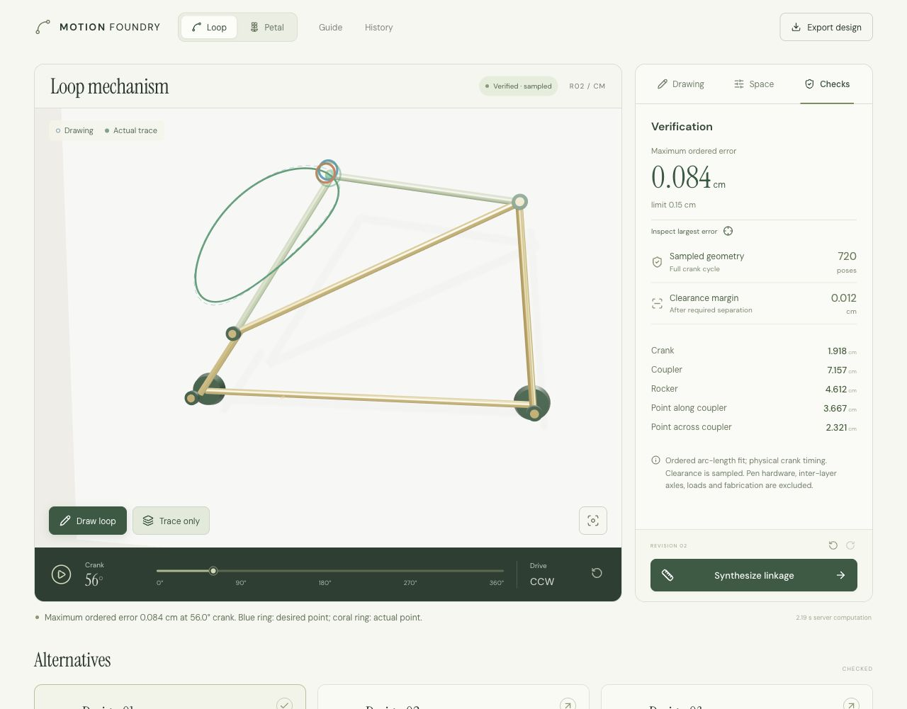
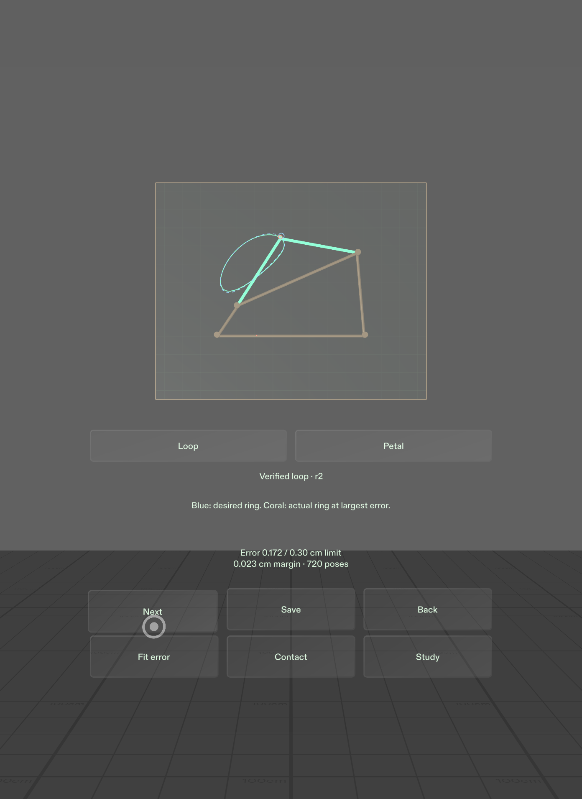
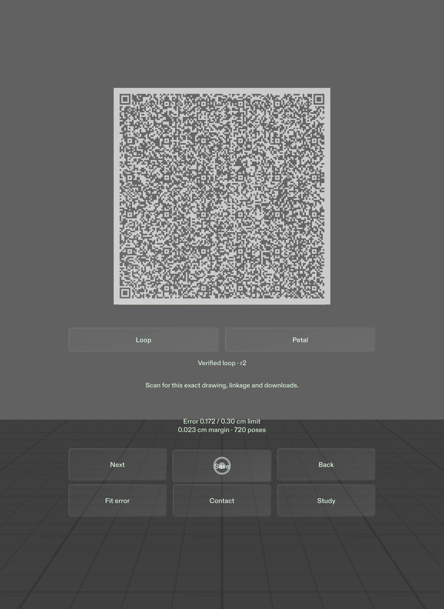
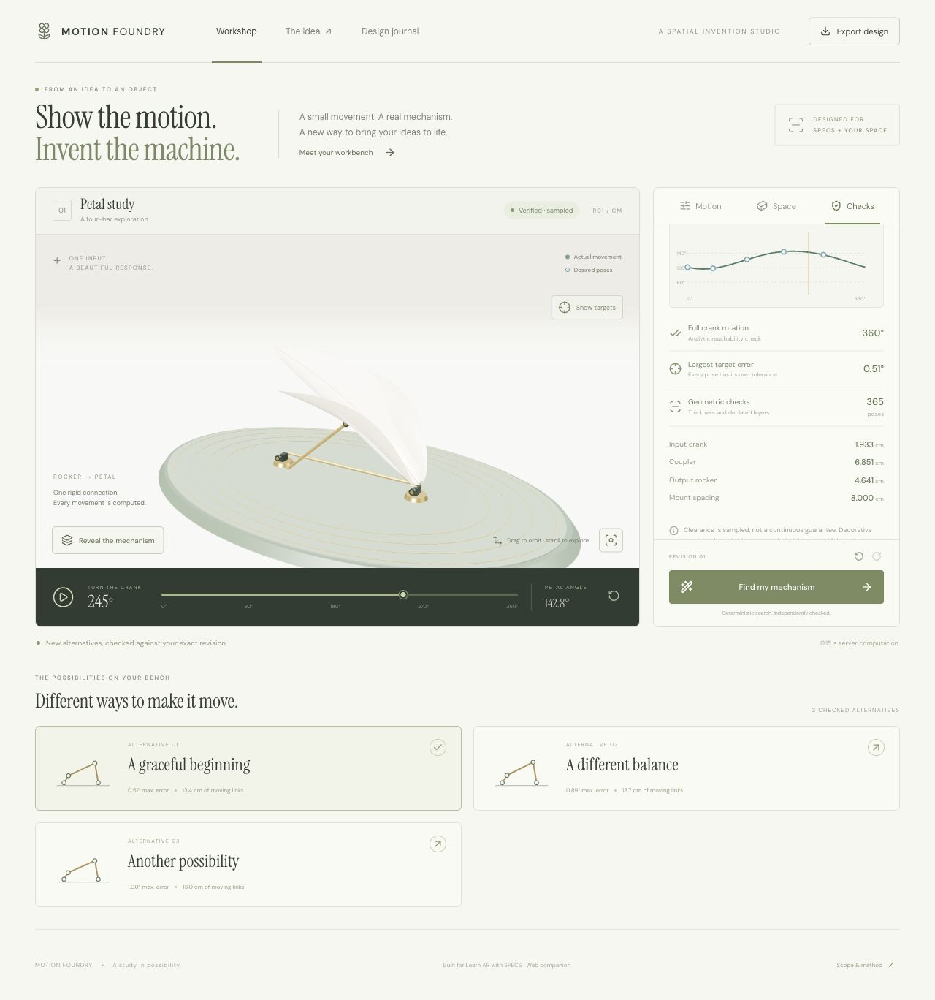
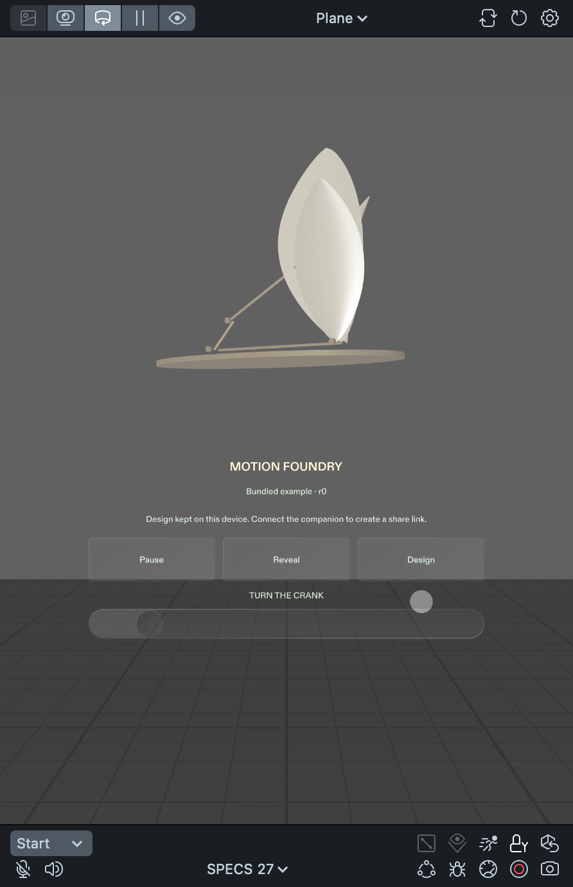
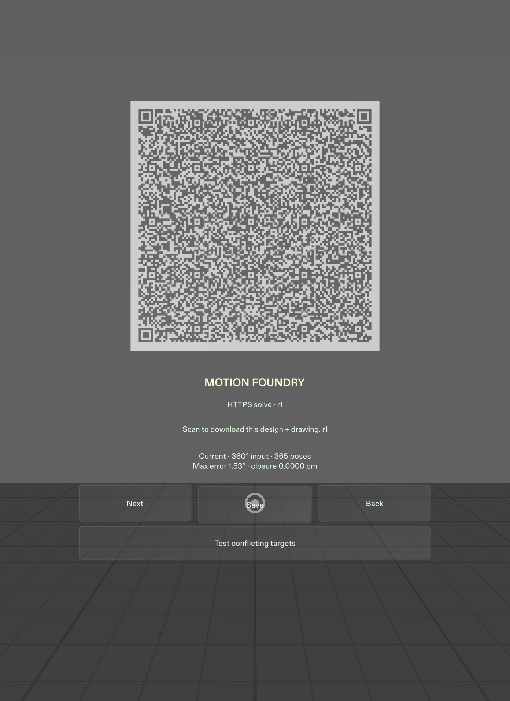

# Verification record

Updated November 8, 2026. Results below distinguish the current tabletop work from the accepted November 7 release and keep local, hosted, Preview and device evidence separate.

## Tabletop revision — acceptance in progress

The source adds direct board drawing, a physical crank, kinematic ink, thicker verified rods, through-axles, contextual tools, on-geometry information, declared-prop repair, spatial cues, one-shot surface placement and a side QR tag. The numerical engines, verifier implementations, HTTPS contracts and signed export formats are unchanged.

`npm run verify` passes **46 tests across five files**, all four fresh Petal fixtures and a production build. Nine new tests check the exact capsule mesh envelope/normals/winding, local ray-plane projection, crank seam/reversal, fit-dial bounds, physically evaluated ink, and the deliberately thicker native input. `npx tsc -p tsconfig.lens-source.json` passes against the installed Lens/SIK/UIKit/LEAF sources.

The current provided low container has a 4.5 cm radius, 4 cm height and centre (−8.90, 0) cm at vertical centre 2 cm. The reference rod physically overlaps it by 0.050 cm; with the required separation its margin is −0.210 cm. A fresh local solve returns three valid alternatives while preserving the drawing, 16 cm mounts and 0.30 cm limit. The selected crank changes from 4.000 to 3.766742 cm, with 0.242353 cm maximum fitting error and +0.023258 cm sampled clearance margin. The nine focused native tests and native typecheck passed again after this fixture change. See the [exact numerical record](evidence/native-tabletop-numerical.json).

### Clean native checks on the final container

The actual native LEAF journey passed in **12.759 seconds** in Sunlit Room. A scripted SIK open stroke required explicit closure, then a fresh HTTPS solve produced **0.066984 cm** maximum fitting error at revision 2 / `fnv1a-976edc17`. A **1.01547-radian** SIK crank movement preserved the input and grew ink. The distinct provided-container Study then repaired at revision 3 / `fnv1a-3049b059`, changing the crank to **3.766742 cm** with **0.242353 cm** maximum error and **+0.023258 cm** sampled margin. Every Study input field stayed unchanged across that repair. Study loads its own reference drawing; it does not add an obstacle to the preceding drawn input.

The final audio snapshot recorded **tick 3 / contact 1 / clear 3**, three configured voices and `failed=false`. These are successful scheduling counts, not acoustic or hardware measurements. The native runtime interval had no product/audio error; unrelated host authentication telemetry warnings remain outside that claim.

A separate direct-reach/mount-edit/Undo run passed native runner and runtime checks in **22.53 seconds**. The target was required to route directly, with fail-fast IK diagnostics. Both hand meshes were confirmed restored to their original tracking parents before the shared right-hand driver was acquired. A real mount drag created one revision; no-motion input created none; Undo restored the exact prior input, mechanism and candidate state. There were no Serialize warnings or audio failures. The [sanitized native receipts](evidence/native-tabletop-leaf.json) retain observed values and source-record hashes.

Earlier attempts remain failure history: the first geometry pass exposed an audio lifecycle error, and a later reach run passed assertions but failed cleanup because two test drivers simultaneously wrapped the same SIK hand. Fixed per-track audio voices and explicit public IK disposal resolved those issues. The earlier taller-prop repair numbers are superseded.

The current native source captures are independently accepted: an **82.1-second uncut main sequence**, a native camera orbit, close reference detail and a real **SPECS Center** view. The main source clock slope is **0.999979**, with two complete physical cycles and 449-frame decoded cycle recurrence at 30 fps. The new drawn input, revision 2 / `fnv1a-3e15a867`, produced **0.064951 cm** maximum error. Its later visible Study is a separate reference input; the fixed Study repair still yields the exact r3 values above. [Capture measurements and gallery provenance](evidence/native-tabletop-captures.json) record the crops, source hashes and measured quantities.

The main drawing is automated LEAF input through SIK using a supplied reference-path stroke; it is not human freehand. The separate accepted reach excerpt uses synthetic SIK hand meshes without the camera-filling avatar visualizer. Its full native test passed, but the film does not present its 0.02 cm mount nudge as a clearly visible interaction demonstration. Native microphone/system audio was not recorded. Scheduling evidence and any editorial replacement of the original cue assets remain separate.

The saved production scene was then cleaned of active diagnostic bindings, the scenario index and LEAF messaging bridge. Native compilation succeeded and a fresh runtime started with no product errors. The [clean-start record](evidence/native-tabletop-clean-start.json) binds that scene hash; test source and packages remain available for deliberate reproduction.

The final product verification was repeated after adding the isolated export capture test: **46 tests across five files, typecheck, four example fixtures and the production build passed**. All **24** canonical product/test TypeScript files also compile against the installed native APIs. The fresh side-tag decode and actual companion match are accepted: decoded input and mechanism deeply equal the main Study, with a valid signature and 720 reverified samples. [Sanitized handoff receipt](evidence/native-tabletop-handoff.json). The [156.1-second edited film](film-review.md) passed independent encoded QA and complete browser playback; user approval remains pending. Optional explicit placement remains unverified. The [tabletop record](native-tabletop.md) is the active checklist; earlier captures below remain historical.

## Earlier accepted Loop release

The primary Loop web/API release is **b74b35e**, deployed at [motion-foundry-nine.vercel.app](https://motion-foundry-nine.vercel.app). The native Loop workflow has also passed actual Interactive Preview acceptance against that production service. The earlier Petal native results are retained below and labeled separately.

## November 7 automated checks

`npm run typecheck` passed. `npm test` passed **37 tests across four files**: 13 Loop domain tests, seven Loop API/export tests, nine Petal domain tests and eight Petal API/export tests. All four fresh Petal fixtures and the optimized production build passed. All **ten native source mirrors** match their final recorded SHA256 hashes. Native compilation passed. The final product-runtime interval and fresh debugger-detached startup were clean; host cleanup warnings are recorded separately below.

Loop coverage includes a held-out mechanism different from the starter, both assembly branches, attachment-coordinate variation, correct reversed drive, a physically generated self-intersecting path, incorrect crossing order, independent pose/closure math, impossible bounds and bounded no-fit behavior. Search preserves fixed mount spacing, physical units, tolerance and obstacles. Constraint-aware synthesis finds a slightly worse-fitting but clear mechanism for the obstructed study, including at the native 2× physical scale.

Witness tests check base-link and attachment contacts and compare the largest-error witness's physical position with the separate playback evaluator. API tests check exact canonical and unquantized input round-trips, selected-candidate exports, tampering, token-purpose separation, malformed input, bounded decompression, obstacle/layer details in SVG and response rejection after edits, cancellation, retry or stroke reordering. The independent review also checked cyclic starting-point shifts and rejection of unrefitted translated targets.

The retained Petal suite covers continuous playback, individual angular tolerance and wraparound, capsule thickness and layers, singularities, strict parameter validation, deterministic repeatability and held-out mechanisms. Its API suite additionally covers production signing requirements, key rotation, oversized Unicode shares, raw-candidate revalidation and large accepted drawing dimensions. Neither suite treats a bounded search failure as proof of impossibility.

## Loop browser and production evidence

Browser review covered the real application on desktop and a 390 × 844 mobile viewport. The mechanism and draw controls remain in the first viewport, DM Sans is the actual computed font, and no horizontal overflow was observed. The final production page and export flow had no console errors.

A real pointer-drawn partial stroke remained open until explicit **Close loop**. A fresh solve produced changed mechanism parameters with about **0.099 cm** maximum error. A large pointer-drawn rectangle exceeded its declared limit and returned no-result; prior geometry remained visible, export was disabled, and Undo recovered. Cancel, retry and Undo during a pending request restored the accepted revision. Switching to Petal, solving its Compact study, then returning to Loop preserved the accepted Loop design.

The clearance-study flow passed in the browser: inspect the reference crank contact, solve, inspect the maximum-error witness, export and share. The generated SVG includes the declared obstacle, its layer/depth context and sampled clearance result. Desired and actual traces are distinct; the largest-error view pauses at an actual physical crank pose.

The production check retained the exact drawing, **8 cm mounts** and **0.15 cm fit limit**:

| Production Loop result | Observed value |
| --- | --- |
| Solve / selected export / share / signed page | HTTP 200 for each |
| Fresh alternatives | 3 |
| Revision / input hash | 2 / `fnv1a-529cf07a` |
| Server-reported solve time | 2,213.39 ms for this request; not a latency benchmark |
| Maximum / RMS fit error | 0.0843960311 / 0.0453674929 cm |
| Sampled clearance margin after required separation | +0.0117463963 cm |
| Maximum closure residual | 6.2172489379e-15 cm |
| Verification poses / failures | 720 / none |
| Exact exported input round-trip | Passed |
| Signed URL / QR size | 1,586 characters / 133 modules per side |

The [sanitized production record](evidence/loop-web-production.json) contains the exact input, selected parameters and verifier report. These numbers establish a real computed repair under fixed constraints. They do not establish continuous collision freedom or manufacturing accuracy. The URL/QR dimensions above describe this web request; the independently decoded native cards are recorded below.

## Earlier native Loop acceptance

Environment: Lens Studio 5.23.2, SPECS 27, Interactive Plane Preview, SIK 0.18.0 MouseInteractor and UIKit. Actual injected mouse gestures drove the authored pen, buttons and sliders. Before/after runtime snapshots and physical transforms confirmed the effects; a successful input-injection call alone was not treated as proof. That accepted release used root `(0, 0, -110)` cm with identity rotation/unit scale and an identity camera. The current tabletop revision supersedes that placement; its production endpoint is unchanged.

| Actual native interaction | Observed result |
| --- | --- |
| Draw and release open | The pen captured 132 ordered samples. The large remaining gap stayed open and required Close. |
| Explicit Close and fresh Solve | Close committed 64 canonical points at revision 1 / `fnv1a-7a3f14d6`. HTTPS synthesis returned two changed, independently verified mechanisms; selected maximum error was 0.1939337773 cm under the unchanged 0.30 cm limit. |
| Point edit and no-op handling | A real drag changed point 1 x from 7.258 to 7.398 cm. After the no-op fix, fresh solving kept revision/history at 1 / `fnv1a-02355194` and returned 0.1078064294 cm error. A grab/release without movement retained the exact hash, revision and history. |
| Play, Reveal, crank and Next | Physical geometry and rod visibility changed. An actual slider drag set phase 5.29127574 rad and paused. Next changed the selected mechanism; Fit error paused at its physical witness. |
| Large completed stroke and recovery | A real large closed drawing returned bounded no-fit, retained prior parameters and rejected stale Save. Undo restored the exact reference input and candidate. |
| Mount, fit limit and obstacle controls | Separate real slider edits reached 16.870 cm mount spacing, 0.384 cm fit limit and obstacle x 6.204 cm. Undo restored each input; these temporary edits did not relax the clearance study. |
| Petal regression | Actual mode controls, HTTPS solve and sampled checks passed; returning to Loop retained its state. |

The [captured-drawing record](evidence/native-loop-drawing.json) preserves the exact committed drawing and computed parameters. These initial drawing captures preceded only narrow no-op, success-copy and display-ring refinements; affected interactions were checked again. A supplemental same-value scalar method check also preserved history, but is not presented as a gesture test.

### Fixed-constraint native repair

Actual Study loaded the reference and an obstacle at `(4.24, 0)` cm, radius 0.06 cm, layer 0 and depth 0.4 cm. Contact paused at crank phase 0 and showed a **−0.140 cm** margin. Fresh solve/retry retained every input field, including the drawing, **16 cm mounts**, **0.30 cm fit limit**, bounds, rod dimensions, layers and obstacle.

| Selected repaired result | Observed value |
| --- | --- |
| Revision / input hash | 2 / `fnv1a-351f40a1` |
| Fresh alternatives | 3 |
| Ground / crank / coupler / rocker | 16 / 3.8365212798 / 14.2896066999 / 8.9533396882 cm |
| Attachment along / across | 7.2337209529 / 4.7907343215 cm |
| Maximum / RMS fit error | 0.1723420112 / 0.0906477379 cm |
| Sampled clearance margin after required separation | +0.0234787202 cm |
| Independent verification | 720 poses; valid; no failures |
| Fit-witness crank phase | 0.9750417900 rad, about 55.8668° |

At the inspected error pose, the desired point is `(6.9653390588, 10.5984478324)` cm and the actual tracing point is `(6.8500011512, 10.4703895025)` cm. Blue/coral display rings and their connector leave both exact positions visible.

A separate audit compared all six rendered rod endpoint transforms with kinematics: maximum discrepancy was about 1.44e-6 cm; the tracing marker's rigid-attachment discrepancy was about 8.38e-7 cm. An independently written circle-intersection calculation agreed with all 361 exported tracing poses within 8.89e-16 cm. These are numerical/rendering comparisons, not measurement accuracy. Separate midpoint-contact fixtures correctly rejected and named crank, coupler, rocker, ground, attachment-B and attachment-C.

### Recovery and request identity

Supplemental transport fault injection delayed delivery of genuine production HTTP responses, without substituting response bodies or geometry. Actual SIK Cancel, Undo and Loop→Petal actions prevented late responses from installing stale results. The real controls also exercised an approximately 28.08-second solve timeout and 20.04-second Save timeout, followed by successful retries.

In the overlapping Save check, the older response arrived while the newer request was still pending. `sharing` remained true and the export URL remained empty; only the newer response completed that Save. The temporary delay wrapper was removed and Preview reset afterward. These artificial delays are not normal performance measurements.

Three ordinary request-to-observed-settled samples were 4.201, 2.103 and 2.519 seconds with a debugger attached. They include network, JSON parsing, local independent acceptance and a following frame. They are desktop observations, not an isolated verifier benchmark or glasses-performance claim.

### Actual QR and exact handoff

Both raw-reference Save without a receipt and solved-receipt Save ran through native controls. **ZXing-C++ automatically decoded both untouched full 1392 × 1910 Preview frames**, with no crop, manual corners, short-link substitution, resized card or generated fixture.

| Native card | Exact decoded URL | Production result |
| --- | --- | --- |
| [Raw reference](media/native-loop-raw-share.png) | 1,390 characters; exactly matches runtime URL | Signed page, JSON and SVG HTTP 200; exact reference input/parameters |
| [Solved receipt](media/native-loop-solved-share.png) | 1,598 characters; version 29, 133 modules, four-module quiet zone, error correction L | Signed page, JSON and SVG HTTP 200; exact input, revision/hash, selected candidate, parameters and units |

A separate real browser opened the native receipt URL and downloaded JSON. Recursive comparison matched every native input field, mechanism parameter, selected candidate and hash. The downloaded result passed 720-pose verification with the same reported error. Tiny verifier differences across JavaScript engines were around 1e-15; comparisons used 1e-10 tolerance, while inputs and parameters matched exactly.

The [sanitized native production record](evidence/native-loop-production.json) includes exact input/parameters, native and downloaded verification, geometry checks, source/screenshot hashes, QR/download proofs, timing scope and the independent browser comparison. It contains no credentials or private workspace paths. The card is the unchanged 26 cm renderer; a successful image decoder does not establish physical phone-camera scanning.

### Final source and runtime

The acceptance fixes were confined to no-op guards and concise success status in LoopController, collapsing empty detail space in LoopWorkshopUI, and display rings in LoopAssembly. The numerical core and backend did not change. All ten authored/imported mirrors match the final recorded hashes; compilation passed.

The final-source Lens runtime interval contained zero warning/error/fatal lines. Two host Qt socket-disconnect warnings occurred after debugger cleanup and are retained separately; the complete host log is therefore not described as warning-free. A fresh startup with the debugger detached was fully clean and reached Ready. The project was saved on primary Loop home, and debugger cleanup left no breakpoints. No native integration blocker remained.

## Earlier Petal fixture results

Fresh fixture results:

| Input | Status | Alternatives | Search evaluations |
| --- | --- | ---: | ---: |
| Baseline | Succeeded | 3 | 69,470 |
| Obstacle before relocation | Succeeded | 3 | 68,612 |
| Obstacle after relocation | Succeeded | 1 | 68,612 |
| Conflicting same-phase targets | Infeasible | 0 | 0 |

The obstacle-after result changed the three moving link lengths to approximately 1.617, 6.898, and 4.019 cm. The old result failed the relocated obstacle. The new result passed 365 sampled poses with about 3.13° maximum target error under its declared 6.88° tolerance. These are genuine fresh numerical results, not labels attached to a preset animation.

## Earlier Petal browser and provider review

The development application on port 3101 and the production build on port 3103 were inspected in a real browser. Desktop and 390 × 844 mobile layouts were checked. The final reviewed production build had no browser console errors.

The review exercised baseline synthesis, three alternatives, Reveal, Space edits, the clearance challenge, contradictory-input failure, Undo, fresh solving, and JSON downloads. A real OpenAI request produced five proposed target edits; acceptance followed by a fresh numerical solve succeeded. The model response was displayed as a proposal requiring verification.

Provider evidence: `gpt-6.1-sol` completed a real OpenAI generation. The Gemini identifier was initially selected from the live [Vercel AI Gateway model catalog](https://ai-gateway.vercel.sh/v1/models), then independently tested through the configured **direct Google SDK** and actual Gemini key. `gemini-4-argon` returned a successful structured proposal in 5.37 seconds, using 659 input and 108 output tokens. The app's `intentSchema` accepted all five target angles, null mount change, and explicit numerical-solve uncertainty. The test used the same 23-second deadline, 2,200-output-token cap, and zero retries as the application. The [sanitized result](evidence/gemini-structured-proposal.json) is retained. Forced OpenAI-to-Gemini failover in production has not been exercised; the two successful provider calls do not establish that separate path.

The final signed-link flow was opened in a fresh tab. The page revalidated signature and geometry, displayed the generated dimensioned assembly drawing, and downloaded the matching JSON. QR generation and the corresponding link were present in the export modal.

The production service is deployed at **https://motion-foundry-nine.vercel.app**. Its unauthenticated health check returned HTTP 200 with AI and signing configured. The earlier Petal native solve and both Petal production sharing paths were subsequently verified as described below.

## Earlier Petal Lens Studio Preview

Environment: Lens Studio 5.23.2, SPECS 27, Interactive Preview, Plane/Front view. Tests injected real Preview gestures routed through SIK MouseInteractor, UIKit, and the authored drag component. Runtime state and visible results were checked after interaction. Final compilation succeeded and fresh runtime diagnostics contained no errors.

| Interaction | Observed result |
| --- | --- |
| Play/pause | Phase advances; captures at different times show different geometry and slider positions. |
| Reveal | Petal hides and 72 trajectory dots appear; toggling restores the petal. |
| Crank slider | Actual drag changed phase from about 3.8973 to 2.4647 rad and paused playback. |
| Contextual navigation | Browse, Design, Checks, Back, and Done respond to actual input. |
| Local Solve | Revision 0 returned three independently verified alternatives. |
| Mount edit and Undo | Spacing changed from 16 to about 18.5958 cm; stale state appeared; Undo restored the verified input. |
| Pose handle drag | Target changed from about 1.77215 to 1.85540 rad, creating one revision and pausing playback. |
| Solve after pose drag | Fresh dimensions were approximately 16 / 4.16598 / 14.03814 / 11.13838 cm. |
| Obstacle edit | Space created an obstacle and edited revision; Undo restored the earlier state. |
| Contradiction and recovery | Solve reported disjoint same-phase tolerances, retained previous geometry, and Undo recovered. |
| Next and local Save | Selected an alternative and persisted its native parameters; the UI explicitly said sharing requires the companion. |

A supplemental direct-method regression solved two revisions, restored the earlier one, and selected Next. It confirmed the original alternative IDs and valid input hash were restored. This supplemental check is not presented as a gesture test.

The native QR renderer was also tested with a direct-method fixture containing the text “Motion Foundry Preview QA.” OpenCV decoded that exact text from an actual Preview screenshot. A real UI action then dismissed the card. This validates the renderer, not a production link request.

## Earlier Petal native production solve and sharing

The native project was saved with `https://motion-foundry-nine.vercel.app` as its backend. Actual Preview gestures through SIK moved a pose target, creating revision 1 with input hash `fnv1a-da84cad4`. Pressing Solve sent that revision to the HTTPS service. The result carried a solve receipt and was independently rechecked inside the Lens before the UI reported **HTTPS solve**.

| Solved native result | Observed value |
| --- | --- |
| Selected candidate | `fnv1a-da84cad4-1` |
| Ground / crank / coupler / rocker | 16 / 4.1617773253 / 14.0369160592 / 11.1079327177 cm |
| Assembly branch | 1 |
| Local verification | Valid; no failures; all five targets passed |
| Verification poses | 365 |
| Maximum target error | 0.026631663964 rad, approximately 1.526°, within the 2° tolerance |
| Maximum closure residual | 8.881784197001252e-15 cm |

Actual Checks → Save exercised two distinct production paths. A freshly reset bundled example, revision 0 / `fnv1a-4799adc5`, had no receipt and sent its raw input/candidate for server re-verification. The edited HTTPS result, revision 1 / `fnv1a-da84cad4`, sent its receipt and selected candidate ID. Both returned signed URLs and displayed native QR cards. Each exact runtime URL opened an HTTP 200 design page; the JSON and SVG download links from both pages also returned HTTP 200.

The revision-1 JSON exactly matched the native revision, input hash, candidate ID, and mechanism dimensions. Native and downloaded verification both passed 365 poses with no failures and identical maximum closure residuals. Their largest target-residual difference was 4.440892098500626e-16 radians. The JSON additionally contains 361 trajectory samples, which are distinct from the verification sample count.

### Earlier Petal rendered QR evidence

**ZXing automatically decoded both full, unmodified 1392 × 1910 Preview screenshots.** No crop or manual corner input was used. The bundled card yielded a 1,068-character URL and the solved card a 1,134-character URL; both exactly matched their runtime export URL. These were actual rendered production cards, with no regenerated QR or backend module reconstruction.

An independent OpenCV 4.13.0 check also recovered both URLs from unchanged screenshot crops. Its bundled-card detector succeeded after cropping; the dense solved card needed four corners measured from the rendered ink bounds. Automatic detection was unreliable with that OpenCV method, including during a temporary runtime enlargement that was reverted. The stronger ZXing result establishes automatic decoding from these full Preview captures. No physical phone-camera or hardware scanning was tested.

The [sanitized production evidence](evidence/native-production.json) retains parameters, verifier results, download hashes/statuses, screenshot and URL hashes, and both decoding methods without private workspace paths or credentials. Final native compilation succeeded. After debugger cleanup, a fresh runtime reset reported no errors; the project was saved and left in the bundled browse/play state with the production endpoint configured.

## Scope of the result

The verifier checks analytic full-rotation reachability and sampled geometric clearance. It does not prove collision freedom between samples. Adjacent pivot neighborhoods are exempt; decorative surfaces, inter-layer axles, forces, bearings, fabrication, and physical manufacturability are excluded.

No physical glasses, hardware hand tracking, reach comfort or device-performance result is claimed. The new LEAF journey and its outstanding native gates are described separately above. A public demo video and Devpost submission remain separate publication steps.
